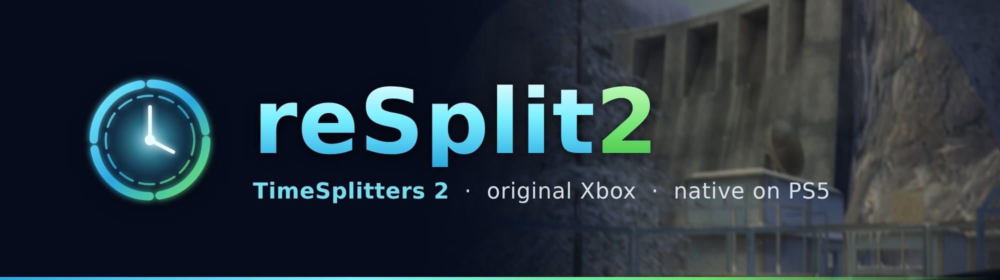
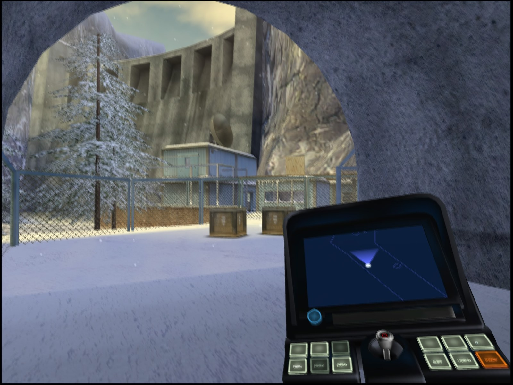
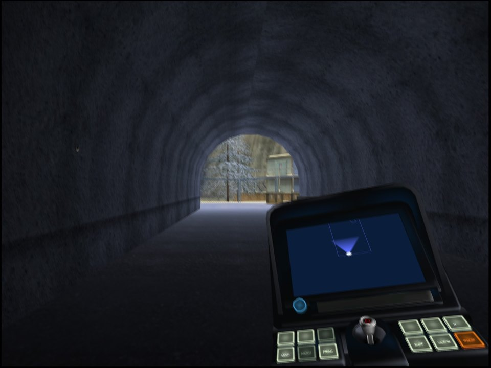
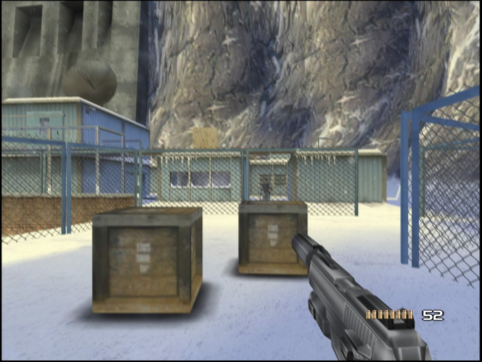
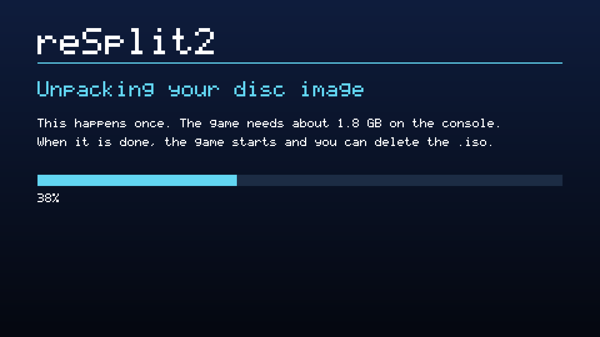

<p align="center">
  
</p>

<p align="center">
  <b>TimeSplitters 2, the original Xbox version, statically recompiled<br>
  into a native app for homebrew-enabled PS5 consoles.</b>
</p>

<p align="center">
  <a href="../../releases"></a>
  <a href="CHANGELOG.md"></a>
  <a href="LICENSE"></a>
</p>

<p align="center">
  <a href="#install"><b>Install</b></a>
  &nbsp;·&nbsp;
  <a href="#controls">Controls</a>
  &nbsp;·&nbsp;
  <a href="#settings">Settings</a>
  &nbsp;·&nbsp;
  <a href="#reporting-a-problem">Report a problem</a>
  &nbsp;·&nbsp;
  <a href="#for-developers">Build it yourself</a>
</p>

> [!IMPORTANT]
> **Bring your own game.**
> The app is the game's program recompiled for the PS5. It contains none of the game's files: the graphics, sound,
> music and levels come from your own disc image of the US Xbox release. Please don't ask for or share disc images
> here.

> [!CAUTION]
> **We do not support piracy.**
> Please don't use this project with pirated copies of the game.

> [!NOTE]
> **Early test builds.** The 0.1.x releases are for testing on real consoles. The story's first level, the menus,
> profiles and saves have been played; expect rough edges elsewhere, and please [report](#reporting-a-problem) what
> you find.

<p align="center">
  
  <br>
  <sub>Siberia, captured on a PS5 at 3840x2160.</sub>
</p>

## What it is

The Xbox game's code is translated into C++ ahead of time and compiled for the PS5, as
[reUndr](https://github.com/bystritskiy/reUndr-ps5) does for Need for Speed: Underground and
[reKing](https://github.com/coru182/reKing) for The Return of the King. It's not an emulator: a replacement runtime
handles the original console's graphics (Direct3D 8 on Vulkan, through Mesa's RADV), sound, input and system
services.

## Highlights

- **Native 4K.** Rendered at 1080p, 1620p or 4K and output at 3840x2160, at the game's own 60 fps on any TV,
  120 Hz ones included.
- **A sharp picture.** The soft filter the game laid over every frame for the TVs of its day is off (the menu brings
  it back), and textures get 16x filtering.
- **The console's own look.** TimeSplitters 2 had no widescreen mode on the Xbox, so its 4:3 picture keeps its
  shape, with bars at the sides. The lens flares, motion blur and screen effects are the game's.
- **PS5 in the game's text.** "Please don't turn off your PS5 console", and your saves live on "PS5 storage".
- **Four-player split screen.** Sign in more users on the PS5 (guests are enough) and turn on their controllers.
- **An in-game menu.** L3 + R3 at any time: render resolution, V-Sync, frame rate counter, texture filtering, the
  soft filter, vibration, stick deadzone and trigger threshold.
- **Disc image install.** Copy your `.iso` to the console and start the app: it does the rest.

<table>
  <tr>
    <td width="50%"></td>
    <td width="50%"></td>
  </tr>
</table>

## Requirements

- A PS5 that runs homebrew, with [ShadowMountPlus](https://github.com/drakmor/ShadowMountPlus) (it registers apps in
  `/data/homebrew`) and an FTP server.
- Your own disc image (`.iso`) of TimeSplitters 2, **US Xbox release**. A full dump and a trimmed one both work.
- About 1.8 GB free on the console for the game's files, plus the disc image until the first start has unpacked it
  (or keep the image on a USB drive).

## Install

1. **The app.** Download `PPSA99064-<version>.zip` from [Releases](../../releases), unpack it, and copy the
   `PPSA99064` folder to `/data/homebrew/` on the console. The **reSplit2** tile appears on the home screen after
   about 30 seconds.
2. **Your disc.** Copy your disc image to `/data/ts2/` on the console (create the folder), or to a `ts2` folder (or
   the top) of a USB drive.
3. **Play.** Start the tile. The first start unpacks the disc image into `/data/ts2/game/`, then the game starts.
   From then on it starts straight away, and **you can delete the `.iso`**.

<p align="center">
  
  <br>
  <sub>The first start.</sub>
</p>

Already have the disc's files (`default.xbe` and the `data` and `music` folders)? Copy them to `/data/ts2/game/`
instead. If the console has no room to unpack the image, the app plays from the `.iso` directly and says so. If the
game is missing, damaged, or another game or release, a screen says so: press Cross to close it.

**To update,** copy the new `PPSA99064` folder over the old one. Your saves, settings and the game's files in
`/data/ts2/` are kept.

## Controls

| Xbox | DualSense |
| --- | --- |
| A B X Y | Cross Circle Square Triangle |
| Black / White | R1 / L1 |
| Triggers | R2 / L2 |
| Start / Back | Options / touchpad click |
| Stick clicks | L3 / R3 |
| | **L3 + R3:** the settings menu |

Player 1 is the user who started the app. Players 2 to 4 are the other signed-in users whose controllers are on, in
the order the PS5 lists them.

## Settings

Press **L3 + R3** at any time; the game stands still behind the menu. L1 / R1 change page, Cross chooses, and
Circle, Options or L3 + R3 go back to the game. Changes apply at once and are saved when you close the menu.

| Page | Settings |
| --- | --- |
| **Picture** | Render resolution (1080p, 1620p, 4K), V-Sync, frame rate counter, texture filtering (16x by default) and sharpness, smooth menus and HUD, the Xbox soft filter (off by default) |
| **Controls** | Vibration, stick deadzone, trigger threshold |

The app's `README.txt` describes every setting.

## Your files

| Where | What |
| --- | --- |
| `/data/homebrew/PPSA99064/` | The app |
| `/data/ts2/game/` | The game's files, unpacked from your disc image at the first start |
| `/data/ts2/settings.toml` | Settings |
| `/data/ts2/hdd/` | Saves (your profiles and progress) |
| `/data/ts2/shadercache/` | Compiled shaders, made as you play (safe to delete) |
| `/data/ts2/logs/` | Logs, only while `/data/ts2/logging-on` exists |

## Reporting a problem

Open an [issue](../../issues): say what you were doing, what you expected and what happened, with a screenshot if you
can. To get a log, create an empty file `/data/ts2/logging-on` on the console and start the game; attach the newest
`/data/ts2/logs/ts2_*.log` and `stderr.log`, then delete `logging-on` again. **Never attach game files or disc
images.**

## For developers

Players don't need any of this: the [Releases](../../releases) have the app ready to copy.

### Building

You need a Linux machine (Ubuntu 24.04; WSL 2 should do) with:

```sh
sudo apt install git cmake ninja-build clang-18 lld-18 llvm-18 llvm-18-dev zlib1g-dev python3 python3-pip patch zip
```

and Docker, for reUndr-ps5's PS5 toolchain. You also need `default.xbe` from your own disc image of the US release:
extract it from the `.iso` with an Xbox ISO tool such as `extract-xiso`.

```sh
git clone https://github.com/coru182/reSplit2.git
cd reSplit2
./setup.sh /path/to/default.xbe     # dependencies, then the game's code recompiled from your default.xbe
./build-ps5.sh                      # the app: build-ps5/PPSA99064-<version>.zip
```

`setup.sh` downloads the pinned dependencies into `deps/` and builds reUndr-ps5's PS5 toolchain with its own scripts
(PayloadSDK, Mesa RADV for the PS5, libc, compiler-rt, the packaging tool), about 20 minutes the first time. With a
built reUndr-ps5 checkout already at hand, pass it: `REUNDR=/path/to/reUndr-ps5 ./setup.sh ...` (and the same
`REUNDR=` for `build-ps5.sh`).

At start the app checks the disc's `default.xbe` against the one it was built from: the same bytes, or the same
release with a few bytes of code changed (`ps5/xbe_match.h`).

### Making a release on GitHub

As with reUndr and reKing, players never need a `default.xbe`: they download the app from **Releases** and use their
own `.iso`. Only whoever makes a release builds it from their own disc, once per version:

1. Set `VERSION` in `build-ps5.sh` (and `contentVersion` in `package/sce_sys/param.json`), then build as above.
2. On GitHub, **Releases > Draft a new release**: a tag such as `v0.1.2`, the title `reSplit2 0.1.2`, the text of
   `.github/release-notes.md` with that version's part of `CHANGELOG.md`, and attach
   `build-ps5/PPSA99064-<version>.zip`. While the builds are 0.1.x, tick **Set as a pre-release**. **Publish
   release.**

### How it fits together

- `game/`: this port's own files over the game template of [Athelas](https://github.com/Shagg88/Athelas) 1.8.2's
  SDK: `config/game.toml`, the recompiler's input (where the XDK library functions the runtime replaces sit in
  TimeSplitters 2, found with Cxbx-Reloaded's
  [XbSymbolDatabase](https://github.com/Cxbx-Reloaded/XbSymbolDatabase) and by hand, and the game's hooks), and
  `src/`: the hooks (the disc check, one frame per 60 Hz blank, the soft filter switch, the PS5 in the game's text).
- `patches/athelas-ps5.patch`: the SDK's changes for the PS5, from reKing: guest memory on 16 KiB pages, threads,
  the Vulkan surface on VideoOut, a logging switch.
- `patches/ts2-sdk.patch`: TimeSplitters 2's: XDK 4721's layout, the vertex and pixel shader programs it sets
  directly, the music stream's playing status, buffer pausing, controller capabilities, and occlusion queries in
  the Vulkan renderer for the lens flares' visibility tests.
- `ps5/`: the PS5 host, from reKing: the entry point, the first start (the disc image unpacked, its screens), the
  app shell and settings, DualSense input for four players (libScePad), sound (sceAudioOut), the in-game menu (Dear
  ImGui), and POSIX calls the PS5 doesn't allow from an app.
- [reUndr-ps5](https://github.com/bystritskiy/reUndr-ps5) by bystritskiy: the pinned PS5 toolchain (mihawk-99's
  PS5_PayloadSDK and PS5_Vulkan with Mesa RADV), its link recipe and packaging tool, and the parts of its PS5 host
  this one follows.
- [XboxXBE-Recomp](https://github.com/TGP482/XboxXBE-Recomp) by TGP482, through Athelas's SDK: the recompiler and
  the Xbox runtime (kernel, Direct3D 8 on Vulkan, DirectSound, XAPI).

## Credits

Made by [coru182](https://github.com/coru182), with Claude (Anthropic). Built on the work of:

- **The game:** Free Radical Design, who made TimeSplitters 2, and Eidos Interactive, who published it.
- **[Athelas](https://github.com/Shagg88/Athelas) by Shagg:** the SDK, game template and renderers this builds on.
- **[XboxXBE-Recomp](https://github.com/TGP482/XboxXBE-Recomp) by TGP482:** the static recompiler and the Xbox
  runtime.
- **[XbSymbolDatabase](https://github.com/Cxbx-Reloaded/XbSymbolDatabase) by the Cxbx-Reloaded team:** how the XDK
  library functions inside the game were found.
- **[reUndr-ps5](https://github.com/bystritskiy/reUndr-ps5) by bystritskiy:** the PS5 port this one is modelled on:
  the pinned toolchain, the link recipe, the packaging tool, the parts of its PS5 host this one follows, and the
  first start's disc image unpacking and progress screen.
- **[PS5_Vulkan](https://github.com/mihawk-99/PS5_Vulkan), [PS5_Mesa](https://github.com/mihawk-99/PS5_Mesa) and
  [PS5_PayloadSDK](https://github.com/mihawk-99/PS5_PayloadSDK) by mihawk-99:** Vulkan on the PS5: Mesa's RADV with a
  PS5 winsys and VideoOut, and the payload SDK's platform layer.
- **[ps5-native-app-boilerplate](https://github.com/blackbearreloaded/ps5-native-app-boilerplate) by
  BlackBearReloaded:** the ELF converter, the fake-signed SELF writer and the clean-room `libc.prx` (through
  PS5_Vulkan).
- **[ps5-payload-dev/sdk](https://github.com/ps5-payload-dev/sdk) by John Törnblom:** the public PS5 headers, sysroot
  and toolchain.
- **[Mesa](https://gitlab.freedesktop.org/mesa/mesa)**, **[LLVM / Clang](https://github.com/llvm/llvm-project)**,
  **[glslang](https://github.com/KhronosGroup/glslang)** and the Vulkan headers (Khronos Group),
  **[Dear ImGui](https://github.com/ocornut/imgui)** (Omar Cornut), **[toml++](https://github.com/marzer/tomlplusplus)**
  (Mark Gillard), **[stb](https://github.com/nothings/stb)** (Sean Barrett) and
  **[Zydis](https://github.com/zyantific/zydis)** (zyantific).

## Licence

reSplit2's own code (the PS5 host, the hooks and the changes in `patches/`) is under the
[GPL-3.0](LICENSE). The app also carries the projects above under their own licences; the app's
`licenses/NOTICE.txt` lists every one.

## Legal

An unofficial fan project, not affiliated with or endorsed by Free Radical Design, Deep Silver, Plaion, Eidos,
Microsoft or Sony Interactive Entertainment. TimeSplitters is a trademark of its owner. No game files are included or
distributed; the screenshots are of the author's own copy.
